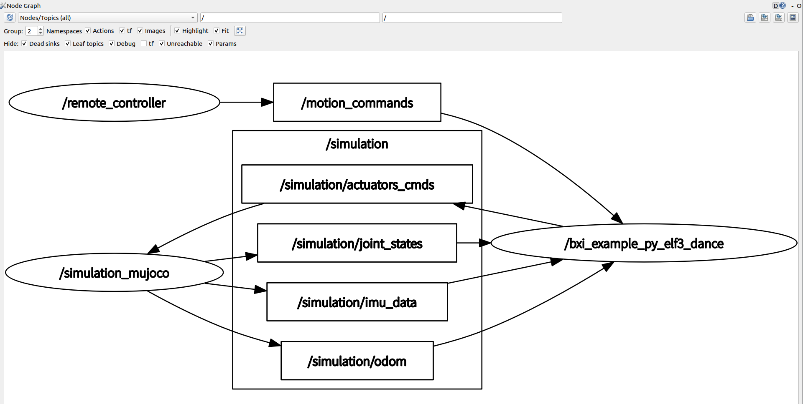

# bxi_rl_controller_ros2_example

[English](./README.en.md)

## 项目概览

本仓库提供 BXI 机器人控制器开发示例框架，包含：

* 基于强化学习控制策略的示例控制程序；
* 基于 ROS2 的 Mujoco 仿真环境；
* 基于 ROS2 的 BXI 硬件环境；
* 读取手柄或键盘输入的 ROS2 遥控器节点。

## 包结构

ROS2 环境和 Mujoco 的二进制 ROS2 包位于 [`bxi_ros2_pkg`](https://github.com/bxirobotics/bxi_ros2_pkg)。

在二进制 ROS2 包 `bxi_ros2_pkg/` 目录中：

1. `communication`：机器人通信包，包含自定义通信消息格式。
2. `description`：机器人描述文件，包括 URDF、XML 和 mesh 文件。
3. `mujoco`：基于 ROS2 的 Mujoco 仿真器。控制程序建议先在 Mujoco 中验证，再部署到机器人硬件。
4. `hardware`：机器人硬件包。该节点发布机器人所有传感器数据，并接收控制命令。
5. `hardware_arm`：机器人上半身版本的硬件控制包。该节点发布机器人上半身手臂信息，并接收控制命令。

[`bxi_ros2_pkg`](https://github.com/bxirobotics/bxi_ros2_pkg) 是仿真和硬件共用的统一框架：

ROS2 仿真结构：

ROS2 硬件结构：

`src/` 目录包含：

1. `src/bxi_example_py_elf3`：Elf3 学习控制策略示例。
2. `remote_controller`：读取手柄或键盘输入并发布控制命令，可用于机器人硬件和仿真环境。

## 描述文件（URDF）

1. `elf3_dof29`：Elf3，29 自由度。
2. `elf3_dof31`：Elf3，31 自由度（头部 2 自由度）。

USD 或 XML 格式请参考：[unofficial models](https://github.com/MelodyAI/TienKung-Lab-bxi/tree/main/legged_lab/assets/elf3_lite)。

## 使用说明

### 中文扩展文档 / Wiki

新增遥控器/输入控制器、添加机器人业务状态、配置状态转移、过渡行为、`on_bind(ctx)` 状态订阅和 `get_cmd_vel(ctx)` 速度处理，请参考项目 Wiki：

* GitHub Wiki：<https://github.com/bxirobotics/bxi_rl_controller_ros2_example/wiki>

### 硬件和仿真环境切换

1. `hw` 是 `hardware` 的缩写，所有带 `hw` 后缀的 `launch` 文件都会启动真实硬件，请谨慎使用。
2. 仿真环境和机器人硬件共用同一套控制程序。只需要使用不同的 launch 文件即可在仿真和硬件之间切换。仿真代码的话题带有 `simulation/` 前缀，硬件话题带有 `hardware/` 前缀。详情请参考 `src/bxi_example_py_elf3` 中的话题参数配置。
3. 仿真环境默认保留虚拟悬挂，不自动释放或进入学习策略。先检查关节映射和低增益控制，再显式释放；机器人硬件运行时会忽略悬挂相关信号。
4. 仿真环境中存在全局里程计话题 `odm`，硬件环境中没有该话题。

替换仿真 XML 时，几何与关节定义并不足以接收电机命令。模型还必须包含与命令关节同名的 `<actuator>` 电机，以及仿真桥使用的 `imu_in_torso` site 和 `torso_ang_vel`、`torso_quat`、`torso_lin_vel`、`torso_lin_acc` 传感器。当前 ELF4 模型提供 29 个同名电机，不包含两个头部关节；控制布局按仿真反馈名称初始化，不应给模型虚构缺失关节。只修改 `robot_name` 或 `<mujoco model="…">` 不能补齐电机接口。更换机器人几何、质量和力矩上限后，原有策略的稳定性仍需重新验证。

当前外部二进制仿真桥还有一个重要限制：按名称查出 actuator 编号后，它按 `qpos[id + 7]` / `qvel[id + 6]` 读取 PD 反馈，假定单个浮动基座加标量关节。故 XML 的电机顺序必须与模型关节遍历顺序一致，**不能按策略关节顺序排列电机**。策略与模型的顺序差异由具名映射处理。仅验证 motor 的 `joint` 属性正确不能排除错误反馈；回归测试同时校验地址偏移和零位闭环负反馈。通用修复应在仿真桥中使用 `actuator_trnid`、`jnt_qposadr` 和 `jnt_dofadr` 解析真实地址；该二进制包的源代码不在本仓库。

`/simulation_auto_start` 默认 `false`，示例仿真 launch 也显式关闭它：两阶段 reset 后不释放基座，也不自动排队 `pd_brake → normal`，当前配置保持 `zero_torque`。这不禁止操作员手动切换状态，也不意味着 ELF3 学习策略已适配 ELF4；仅在模型与策略均已验证的环境才可显式启用自动启动。硬件两阶段 reset 的行为不变。

### 系统环境配置

1. 使用 `Ubuntu 22.04` 和 ROS2 `humble`。`mujoco` 需要安装 `libglfw3-dev`。
2. 遥控器默认使用设备路径 `/dev/input/jsBattleDragon`。个人开发者或本地调试环境需要先配置 udev 规则，才能稳定生成该设备别名。
3. 安装 Battle Dragon 手柄链接脚本并添加执行权限：

```bash
sudo install -m 0755 ./script/bxi-battle-dragon-link /usr/local/bin/bxi-battle-dragon-link
```

4. 安装 IMU、BAT 和遥控器三份 udev 规则，并重新加载。若已安装旧版 `/etc/udev/rules.d/bxi-dev.rules`，请先备份并移出该目录，避免与新规则同时生效：

```bash
sudo install -m 0644 ./script/udev/70-bxi-*.rules /etc/udev/rules.d/
sudo udevadm control --reload-rules
sudo udevadm trigger --subsystem-match=tty --action=add
sudo udevadm trigger --subsystem-match=input --action=add
```

规则按 `uname -m` 区分 `x86_64` 与 `aarch64`，分别使用 `3-8`/`3-9` 与 `4-1.7`/`5-1`。IMU 和 BAT 在各自架构的两个端口都可匹配，设备类型由 USB VID/PID 区分。

重新插拔 Battle Dragon 手柄后，应能看到 `/dev/input/jsBattleDragon`。如果只是本地调试，也可以临时将 `src/remote_controller/config/xbox_default.yaml` 中的 `sources.gamepad.device` 改成当前系统对应的 `/dev/input/js0`。

5. 如需设置遥控器开机自启动，先根据实际路径和 ROS 配置编辑 `./script/ros_elf_launch.service`，然后复制到 `/etc/systemd/system/` 并启用服务：

```bash
sudo cp ./script/ros_elf_launch.service /etc/systemd/system/
sudo systemctl daemon-reload
sudo systemctl enable --now ros_elf_launch.service
sudo systemctl status ros_elf_launch.service
```

部署相关文件的用途见 [`script/README.md`](script/README.md)。

### 源码发布包

`main` 的 AMD64 发布流程在编译成功后，用 `git archive` 打包当前提交的源码，
不包含 `.git` 或未跟踪的构建产物。压缩包顶层目录为 `bxi_rl_controller_ros2_example/`。
CI 复用现有 SSH Secrets，将固定文件名上传到
`${DEPLOY_PATH}/bxi_rl_controller_ros2_example/bxi_ws/`，覆盖旧源码包。
下载地址：[bxi_rl_controller_ros2_example.tar.gz](https://download.bxirobotics.cn/d/ELF3/bxi_rl_controller_ros2_example/bxi_ws/bxi_rl_controller_ros2_example.tar.gz)。

### RK3588 / RKNN 发布包

ARM64 CI 默认生成包含 RKNN 的 `*_arm64.tar.gz` 和 SHA256 校验文件。
该 ARM64 包用于 **RK3588、Ubuntu 22.04、ROS 2 Humble、Python 3.10**，包含同一提交的
ARM64 编译产物、全部内置策略的非量化 RKNN 模型及 `.rknn.build.json` 契约、
RKNN Lite 2.3.2 wheel 和 `librknnrt.so`。原始 ONNX 保留用于回退和轨迹输出。

包解压到 `/opt/bxi/` 后，在目标板执行以下依赖安装命令。板端需已有 ROS 2 Humble、
`bxi_ros2_pkg` 的 ARM64 版本及兼容的 RKNPU 内核驱动；此包不包含内核驱动。

> 安装会更新 Python 依赖并替换 `/usr/lib/librknnrt.so`，请先停止使用这些依赖的控制程序。
> 基础 Python 依赖仍需联网安装；`--check` 只检查导入和动态库加载，不代表 NPU 推理通过。

```bash
sudo -H /opt/bxi/bxi_rl_controller_ros2_example/deploy_environment.sh
/opt/bxi/bxi_rl_controller_ros2_example/deploy_environment.sh --check
```

运行时会优先尝试同名 RKNN，失败时回退 ONNX；确认日志中的 `selected_backend=rknn`。
CI 的 ARM64 runner 负责转换、契约验证和打包，板端推理精度与实机动作仍需单独验收。

在已安装 `rknn-toolkit2==2.3.2` 的 Python 3.10 环境中，可独立运行或复查转换：

```bash
python tools/build_rknn_release.py
python tools/build_rknn_release.py --check
```

### 在仿真器中运行示例控制程序

1. 将 ROS2 二进制包 [`bxi_ros2_pkg`](https://github.com/bxirobotics/bxi_ros2_pkg) 拉取到 `/opt/bxi/bxi_ros2_pkg`：

```bash
mkdir -p /opt/bxi/
cd /opt/bxi/
git clone https://github.com/bxirobotics/bxi_ros2_pkg.git
```

然后激活环境（在机器人硬件上请使用 `root` 用户执行）：

```bash
source /opt/bxi/bxi_ros2_pkg/setup.bash
```

2. 在 `bxi_rl_controller_ros2_example` 目录中运行 `bash build.sh`，编译 `./src` 目录下的所有源码。若当前系统是 RK3588/aarch64，脚本会先检查每个 ONNX 的 RKNN 和构建契约；缺失时自动检查或安装匹配的 `rknn-toolkit2==2.3.2`，再生成 RKNN。编译完成后运行 `source ./install/setup.bash` 激活当前包环境。
3. 运行全身控制策略：

```bash
ros2 launch bxi_example_py_elf3 example_launch_demo.py
```

该命令会启动仿真环境和基于学习的控制程序。

4. 启动键盘控制节点：

```bash
ros2 launch remote_controller remote_controller_keyboard.launch.py
```

### 在硬件中运行示例控制程序

0. 使用 `root` 用户登录。
1. 将 ROS2 二进制包 [`bxi_ros2_pkg`](https://github.com/bxirobotics/bxi_ros2_pkg) 拉取到 `/opt/bxi/bxi_ros2_pkg`：

```bash
mkdir -p /opt/bxi/
cd /opt/bxi/
git clone https://github.com/bxirobotics/bxi_ros2_pkg.git
```

然后激活环境（在机器人硬件上请使用 `root` 用户执行）：

```bash
source /opt/bxi/bxi_ros2_pkg/setup.bash
```

2. 在 `bxi_rl_controller_ros2_example` 目录中运行 `bash build.sh`，编译 `./src` 目录下的所有源码。若当前系统是 RK3588/aarch64，脚本会先检查每个 ONNX 的 RKNN 和构建契约；缺失时自动检查或安装匹配的 `rknn-toolkit2==2.3.2`，再生成 RKNN。编译完成后运行 `source ./install/setup.bash` 激活当前包环境。
3. 运行全身控制策略：

```bash
ros2 launch bxi_example_py_elf3 example_launch_demo_hw.py
```

该命令会启动机器人硬件和控制策略。

如果已经使用 `bxi_robot_config_tool` 生成 `/opt/bxi/robot_config.yaml`，硬件 launch 会自动读取该文件；文件不存在时继续使用内置默认值。也可以手动指定：

```bash
ros2 launch bxi_example_py_elf3 example_demo_hw.launch.py \
  robot_config_file:=/opt/bxi/robot_config.yaml \
  enable_head:=auto
```

`enable_head:=auto` 会读取 `modules.head.enabled`。如需覆盖配置，可使用 `enable_head:=true` 或 `enable_head:=false`。

### 控制程序运行提示

1. 话题中的控制命令必须按照指定关节顺序发送。关节顺序请参考 `src/bxi_example_py_elf3` 中的示例。
2. 仿真环境和硬件机器人都有失控保护。如果控制命令丢失超过 100 ms，保护会被触发，电机将失能，系统必须重新初始化后才能继续使用。
3. 遥控器默认设备为 `/dev/input/jsBattleDragon`。如果 udev 规则尚未配置，或调试时只想使用系统当前识别到的手柄设备，可将配置中的设备路径临时改为 `/dev/input/js0`。

IMU 停机告警与接收断档排查见 [有序停机与 IMU 接收诊断](src/remote_controller/README.md#有序停机与-imu-接收诊断)。App/API 和遥控器应共用有序停机入口，不能先撤销 IMU 再停止控制器。

### 同话题上下半身反馈同步

分体硬件的下半身与上半身节点都发布 `hardware/actuator_states` 时，真机示例 launch 默认启用 `/joint_state_sync`。仍只建立一个订阅：按消息 `name` 的集合分流为腰腿 15 关节和双臂 14 关节，再进行双队列近似时间配对，输出稳定的完整 29 关节状态。不会把第一条腰腿反馈误认为全身布局，不拼入未测量的零值，不反复复用旧的另一半反馈。消息内关节可乱序；具名映射有界缓存、队列数值缓冲预分配，配对后才在输入锁下原子更新完整状态。同步器属于公共平台 I/O，不放入某个业务 Mod。

同步策略已抽成公共 `framework/platform/synchronization.py`，支持任意 N 路输入（至少两路），不依赖 ROS 消息或节点。实现参考本机 ROS Humble `message_filters` 的时间戳匹配、有界队列、消费配对帧的思路，不新增 `message_filters` 依赖、订阅或线程，也不做插值或等待阻塞。关节订阅 DDS 队列深度为两侧缓存大小之和，其他传感器 QoS 保持原样。

| 节点参数 / 同名 launch 参数 | 默认值 | 作用 |
| --- | --- | --- |
| `joint_state_sync` | 节点 `false`，真机 launch `true` | 分体驱动启用；仿真和关闭时保留原来的完整帧接收方式 |
| `joint_sync_policy` | `approximate` | `approximate`、`exact`、`time`、`queue`，见下表 |
| `joint_sync_slop_sec` | `0.02` | 仅 approximate 生效，时间戳跨度最多 20 ms（包含边界） |
| `joint_sync_queue_size` | `8` | 每侧最多保留 8 帧，可设置 1–64 |
| `joint_sync_timeout_sec` | `1.0` | 按单调接收时间检查配对中较旧一侧的新鲜度，并清理过期缓存；approximate 模式必须大于 slop |
| `joint_sync_use_header_stamp` | `true` | 默认使用非零 `header.stamp`，要求两个发布节点使用可比较的时钟 |

#### 同步策略

| `joint_sync_policy` | 公共类 | 匹配语义 |
| --- | --- | --- |
| `approximate` | `ApproximateTimeSynchronizer` | N 路全部时间戳的最大值与最小值之差 ≤ slop；两路使用最近邻，N 路扫描有界窗口，不枚举指数级组合 |
| `exact` | `ExactTimeSynchronizer` | N 路时间戳必须精确到纳秒相等 |
| `time` | `TimeSynchronizer` | 与 exact 相同；遵循 ROS `TimeSynchronizer` 的精确时间匹配含义 |
| `queue` | `QueueSynchronizer` | 每路按到达顺序各取最旧一帧，不保证时间戳接近；仍限制缓存数量和单调接收年龄 |

**`TimeSynchronizer` 不是不看时间戳的 FIFO 配对器。** FIFO 特意另命名为 `QueueSynchronizer`，避免把“凑齐各队列”误当成设备采样同步。队列模式不会因时间戳重复或倒序而拒收新到达的帧；时间模式会丢弃重复时间戳及早于已消费水位的帧。exact/time 关节同步必须启用有效 header 时间戳；两个独立 `now()` 的发布节点未必能精确相等，分体硬件默认保持 approximate。FIFO 只能在明确接受较弱同步保证时手动启用。

公共组件可以从 `bxi_example_py_elf3.framework.platform` 导入；这是本框架的轻量 API，不是 ROS `Subscriber/registerCallback` 的直接替代。调用方须串行调用 `add`，它不自带锁或回调线程。示例：

```python
from bxi_example_py_elf3.framework.platform import ExactTimeSynchronizer

sync = ExactTimeSynchronizer(stream_count=2, queue_size=8, timeout_sec=1.0)
sync.add(0, 1_000_000_000, "lower", received_at=1.0)
result = sync.add(1, 1_000_000_000, "upper", received_at=1.001)
if result.samples is not None:
    lower, upper = (sample.value for sample in result.samples)
```

`result.accepted` 区分“合法入队但暂未匹配”与“重复/过时而被拒收”；每个匹配返回按流编号排列的 `SynchronizedSample(timestamp_ns, received_at, value)`。组件按引用保存 payload，调用方不能提前修改未消费的 payload；关节适配器通过固定数值槽位和 `key` 机制复用缓冲。`clear()` 可显式清空缓存并重置时间水位，`clear(watermark_ns=...)` 则用于接收完整单帧后推进水位；时间戳不会自动猜测复位。诊断包括策略、接收数、队列深度、匹配数和丢弃数。

例：

```bash
# 默认近似时间同步，调节容差
ros2 launch bxi_example_py_elf3 example_demo_hw.launch.py joint_sync_slop_sec:=0.03
# 仅适用于两个发布节点具有相同采样时间戳的情况
ros2 launch bxi_example_py_elf3 example_demo_hw.launch.py joint_sync_policy:=exact
# TimeSynchronizer 是同样的精确语义
ros2 launch bxi_example_py_elf3 example_demo_hw.launch.py joint_sync_policy:=time
# 显式选择弱保证的 FIFO；这里只按接收顺序配对
ros2 launch bxi_example_py_elf3 example_demo_hw.launch.py joint_sync_policy:=queue joint_sync_use_header_stamp:=false
```

approximate 模式下无有效时间戳的旧驱动必须显式设置 `joint_sync_use_header_stamp:=false`，此时只按本机单调接收时间配对，**不代表设备采样同步**。不能用扩大 slop 掩盖两个节点时钟不一致或长时间传输阻塞。时间同步模式下，重复或倒退到已消费帧之前的时间戳会丢弃；发布时钟复位后需要检查驱动并重启控制器。

`/joint_sync_lower_names` 和 `/joint_sync_upper_names` 是可通过自定义 launch/节点参数覆盖的两组完整名字，不能重叠；开启头部时应把头部反馈按实际发布分组加入相应列表，以构成 31 关节布局。默认与当前真机 launch 的 `arms=true, head=false` 一致。启用同步时也接受包含配置集合的完整单帧，但不接受多余或不完整的未知分组；关闭同步时保留完整 29/31/N 帧的原有行为。

启动期间保持等待，直到收到完整、新鲜的配对，再执行两阶段 reset；IMU 启动检查不变。运行期间一侧断流或持续无法配对，超时后通过现有控制调度器故障路径停止控制器和命令发布，日志明确标为 **joint feedback synchronization timeout**，不伪装成 IMU 故障。停止发布不等价于硬件已失能，分体驱动的命令 watchdog/失能策略仍需独立验证；关节数据配对也不代表驱动已完成使能。

离线回归：`python3 -m pytest -q src/bxi_example_py_elf3/test/test_synchronization.py src/bxi_example_py_elf3/test/test_joint_state_sync.py`（加载 ROS 与本包环境，不启动硬件）。模型、动作、normal 双臂 PD 覆盖和仿真 actuator 均不受此同步改动影响。

### 控制性能与整机 CPU 统计

`control_runtime` 的性能日志采用以下口径（硬件与仿真共用）：

- 仅调度唤醒延迟超出 `deadline_tolerance_sec` 时不再打印 warning，但仍计入 INFO 性能汇总的时序异常次数和 P99 唤醒延迟。真正的周期完成截止超限仍打印节流后的 warning；IMU 等安全告警不受影响。
- 维护线程按 `maintenance_hz` 读取 `/proc/stat` 的整机累计 CPU 计数；当前示例配置为 5 Hz，即约每 200 ms 采样一次。不新增线程、子进程或第三方依赖，控制周期不读取文件。
- 按 `statistics_interval_sec` 输出统计窗口内的整机 CPU **最低、最高、平均**占用率；当前示例配置为 60 秒。最低和最高是各采样区间的平均占用率极值，并非瞬时峰值；平均值按 CPU 时间增量加权。
- 数值是全部 CPU 核心合计后归一化的 0–100%，不是控制进程占用率，也不是各核心占用率之和。idle 和 iowait 不计为忙碌时间，不重复计算 guest 时间。
- 首次采样只建立基线；读取失败或计数异常不会中断控制。日志同时列出有效/无效采样次数，无有效区间时显示“不可用”，不伪装成 0%。

例如，性能汇总末尾会追加：`整机CPU占用率：最低12.50%，最高47.20%，平均23.10%（有效采样300次，无效采样0次）。`

### 启动流程

在仿真和硬件环境中，启动时电机都处于失能状态，所有参数不可控。启动流程分为两步：

1. 使能电机位置控制。电机可通过设置 `pos kp kd` 三个参数实现位置控制。以 Elf2 硬件为例，收到第 1 次 `reset` 命令后，关节会转到零位并保持 10 秒。
2. 使能所有控制参数。电机可设置 `pos vel tor kp kd`。以 Elf2 硬件为例，收到第 2 次 `reset` 命令后，关节开始接收控制输入。

启动示例请参考 `src/bxi_example_py_elf3`。

### 硬件保护

除通信超时保护外，硬件节点还包含力矩保护、超速保护和位置保护。

1. 硬件节点内置错误计数器。当错误计数达到 `1000` 时，电机会退出使能状态。
2. 错误计数逻辑：收到电机速度超限时错误计数增加 `50`；收到力矩超限时错误计数增加 `100`；收到正常电机消息时错误计数减少 `1`，最小值为 `0`。
3. 触发位置超限保护时，不会增加错误计数。超限方向的控制会被禁止，电机只能向相反方向旋转。
4. 详细超限值请联系我们获取。不建议在非必要情况下修改这些数值。

## 重要提示

大型机器人可能带来风险。操作前请仔细确认说明！

所有控制程序必须先经过仿真验证，再部署到机器人硬件。

如发生任何异常，请立即按下急停按钮！
