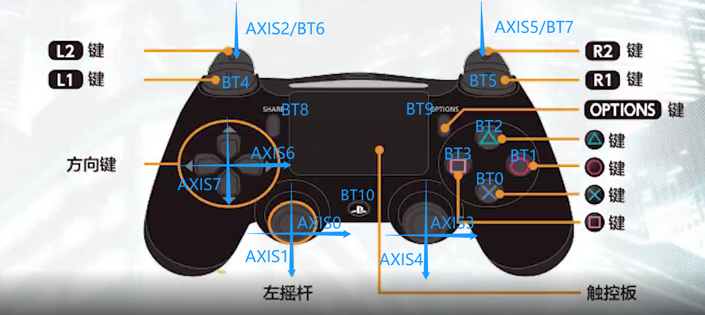

## 按键说明

1. 按键映射对照图片： 
2. 其中AXIS为线性按键，箭头方向为正方向，值范围:-32767 - 32767，除扳机键L2/R2外初始值均为0  
3. 其中BT为常规按键，按下为1，松开为0
4. 方向键属于线性按键，但只有两个值，图示AXIS两端的键分别为最小和最大
5. L2/R2扳机键初始值为-32767，按下后线性增加到最大值，同时扳机键是一个复合按键，按下后同时触发一个常规按键，复合关系看图

## 多设备自动选择

`remote_controller` 将每个 `sources.<设备名>` 视为一个候选输入设备，并且严格只激活一个。候选设备按 `priority` 选择；高优先级设备连续可用 `promote_stable_ms` 后会自动抢占低优先级设备。

```yaml
inputs:
  selection:
    scan_interval_ms: 100       # 驱动可用性扫描周期
    promote_stable_ms: 500      # 高优先级设备稳定多久才允许抢占

sources:
  gamepad:
    type: joystick
    device: /dev/input/by-id/usb-...-joystick
    priority: 50
    ready_timeout_ms: 1000
    loss_timeout_ms: 300
    cooldown_ms: 1000
    signals: { ... }

  keyboard:
    type: keyboard
    priority: 0
    signals: { ... }
```

切换顺序固定为：停止旧驱动、清除旧设备所有信号、发布一次零运动命令、启动新驱动、等待新驱动声明就绪、再允许正常输入。切换期间会抑制所有 edge 输出；因此必须在切换后先松开、再按下 `start/stop` 等边沿按键，避免状态继承造成误触发。设备连续不可用超过 `loss_timeout_ms` 后会被断开，并在 `cooldown_ms` 内不参与再次选择。

`signals.*.timeout_ms` 是单个数据字段的过期保护，只适用于 UDP/TCP 等持续流式输入；它不用于手柄或 CRSF 的设备断连判断。默认手柄配置不设置它，断连统一由驱动的 `is_available()` 和 `loss_timeout_ms` 处理。

`--driver <type>` 和 `--keyboard` 保留为调试过滤器：它们只允许相应类型的候选设备参与选择。正常部署不要传该参数，让 YAML 优先级生效。

## 运行时 driver DEBUG

直接运行节点时添加 `--DEBUG`（也兼容小写 `--debug`），会每秒调用一次每个 input driver 的
`debug()` 并输出诊断信息。CRSF 的诊断包含最近一帧 CRC 正确的 16 路归一化通道值：

```bash
ros2 run remote_controller remote_controller --DEBUG --config /path/to/xbox_default.yaml
```

通过 launch 启动时，ROS 2 的自定义 launch 参数语法是 `DEBUG:=true`：

```bash
ros2 launch remote_controller remote_controller.launch.py DEBUG:=true
```

`ros2 launch --debug` 是 ROS 2 launch 系统自身的调试选项，不会传递给 input driver。

### 添加编译内置的新驱动

新驱动通常继承 `InputDriverBase`（或直接实现 `InputDriver`），并用 `register_input_driver_factory("类型名", factory)` 注册。`InputDriverBase::set_signal()` 已处理与 mapper 的同步。`is_available()` 必须非阻塞；驱动可按自身协议定义可用性。对 CRSF，建议仅在设备打开且近期收到校验通过的完整通道帧时返回可用。`is_ready()` 只有在已收到驱动认为足够安全的完整状态快照时才返回 `true`。

`crsf` 已是内置 driver。它兼容标准 CRC 正确的 CRSF `0x16` 通道帧地址 `0xC8` 和
高频头转接器 `usb_f2` 使用的 `0xEE`。driver 会继续暴露 `crsf.channel.1` 到
`crsf.channel.16` 作为调试/兼容 raw channel，同时按 `usb_f2` 的 ELRS Hybrid/Wide
低延迟协议从 CH1..CH4 的 10-bit 字里还原 Xbox 摇杆和 14 个按钮，输出
`crsf.xbox.*` 原始信号。

默认配置已经包含完整的 `crsf` 候选项；最小配置如下：

```yaml
sources:
  crsf:
    type: crsf
    device: /dev/ttyCRSF
    priority: 100
    ready_timeout_ms: 1000
    loss_timeout_ms: 300
    cooldown_ms: 1000
    baud_rate: 460800
    signals:
      crsf.left_x:        {from: crsf.xbox.left_x}
      crsf.left_y:        {from: crsf.xbox.left_y}
      crsf.right_x:       {from: crsf.xbox.right_x}
      crsf.right_y:       {from: crsf.xbox.right_y}
      crsf.trigger_left:  {from: crsf.xbox.trigger_left}
      crsf.trigger_right: {from: crsf.xbox.trigger_right}
      crsf.a:             {from: crsf.xbox.button.a}
      crsf.b:             {from: crsf.xbox.button.b}
      crsf.x:             {from: crsf.xbox.button.x}
      crsf.y:             {from: crsf.xbox.button.y}
      crsf.lb:            {from: crsf.xbox.button.lb}
      crsf.rb:            {from: crsf.xbox.button.rb}
      crsf.back:          {from: crsf.xbox.button.back}
      crsf.start:         {from: crsf.xbox.button.start}
      crsf.dpad_left:     {from: crsf.xbox.button.dpad_left}
      crsf.dpad_right:    {from: crsf.xbox.button.dpad_right}
```

`usb_f2` 协议约定：

- CH1：左摇杆 X 7 bit + A/B/X 3 bit；
- CH2：左摇杆 Y 7 bit + Y/LB/RB 3 bit；
- CH3：右摇杆 X 6 bit + Back/Start/LStick/RStick 4 bit；
- CH4：右摇杆 Y 6 bit + D-pad Up/Down/Left/Right 4 bit；
- CH5：固定 low，避免 ELRS arm；
- CH6/CH7：LT/RT。

按钮按位同时传输，所以 A/B/X/Y/LB/RB/Start/Back 等组合键不会再被 CH8/CH9 的单一离散值互斥掉。
默认配置中 Start 对应 stop，RStick 对应 start；D-pad 左/右也映射为 CRSF yaw 的 `+1/-1`。
`crsf.channel.1` 到 `crsf.channel.16` 默认按接收机范围 `172..1811` 归一化至 `[-1, 1]`。
未激活时
driver 做非阻塞协议 probe，只有近期收到 CRC 正确帧才会参与抢占；激活后停止收到有效帧
超过 `loss_timeout_ms` 就会断连。尚未编译的其他 `type` 不会导致节点启动失败：节点会记录
warning、忽略该候选项，并自动使用下一个可用设备；没有任何可用设备时保持安全停止。

## 有序停机与 IMU 接收诊断

### 统一停机入口

默认 `system.stop` 调用安装后的公共脚本：

```bash
bash "$(ros2 pkg prefix remote_controller)/share/remote_controller/scripts/stop_robot.sh"
```

脚本先向控制器、硬件及其 launch 父进程发送 INT，保持 IMU 和 guard 存活；确认前一组退出后，
才停止 IMU/guard，最后停止 BMS/语音。每组有界等待并按 INT → TERM → KILL 升级；若控制器/
硬件仍未退出，返回非零并保留 IMU，不伪报成功。命令可重复执行。

**App/API 若自行实现 pkill 而不读取 `system.stop`，也必须改为调用此入口。** 本仓库不包含
外部 App/API server 的停机实现，更新 YAML 不会自动修复其硬编码顺序。不要先杀 IMU、再让
仍运行的控制器等待超时，也不要通过在正常运行时关闭 IMU 保护来隐藏停机告警。

Python 控制器在 ROS context shutdown 时只做非阻塞取消：设置 stopping 标记、唤醒控制/
维护线程，随后由正常析构流程 join。stopping/context 已关闭时不再触发 IMU 故障切换或
发布新的电机命令；正常运行中的断流仍按配置阈值锁存。阈值与诊断逻辑互不替代。

### 两个独立的观察点

1. **控制器日志**：`IMU receive diagnostic` 每 30 秒汇总；真正触发锁存的错误行附
   `imu_receive_diag={...}`。计数为累计值，最大耗时为最近统计窗口，最多保留 16 条异常记录。
   - `last_entry_age_ms`：距最近一次 IMU 回调入口的时间。
   - `last_valid_update_age_ms`：距最近一次有效状态更新的时间。
   - `active_callbacks`：正在执行的输入回调、持续时间与阶段；`wait_input_lock` 表示已经
     进入 IMU 回调但在等输入锁。其他传感器回调长期活跃提示互斥 callback group 被占用。
   - `max_entry_gap_ms` / `max_callback_ms` / `max_input_lock_wait_ms`：分别是入口间隔、
     IMU 回调耗时和输入锁等待；无效帧、异常退出单独计数。
   - `last_header_age_ms`：本机墙钟减消息 header 时间，包括传输/排队/调度影响，
     **不是设备采样年龄**；墙钟不同步或跳变时不能按此数值定因。
2. **独立 C++ 接收日志**：外部 IMU fallback 启动后的现有 `imu_publisher_guard` 自动启用
   `receive_diagnostics:=true`，复用已有订阅，不增进程/线程/高频订阅。日志进入同一个
   `/var/log/bxi_log/imu/imu_*.log`。
   - `IMU independent receive window`：每 30 秒记录带 Unix 起止时间的接收窗口、消息数、
     最大接收间隔、无效消息累计数；计入所有 publisher，所有权检查仍按原 GID 规则进行。
   - `IMU independent receiver silent`：收到首帧后，无输入达到 50 ms 才提示，检查周期
     100 ms，持续静默至多每 5 秒一条。该诊断不切状态、不改变驱动发布或所有权逻辑。
   - 支持的 RMW 会提供 `rmw_source_to_receive_ms` 与 `rmw_receive_to_callback_ms`；
     不支持时为 `null`。这些字段来自**独立订阅者**，其语义/时钟由 RMW 实现定义，不能把
     它们当作 Python 订阅端的精确排队耗时或网络延迟。

判断时对齐同一时间窗口：驱动 CSV 和独立接收都连续、控制器却没有回调入口，优先查
Python 订阅/executor 路径（仍不能排除该订阅自己的 DDS 问题）；IMU 已进入且处于长时间
`wait_input_lock`，则有直接的锁阻塞证据；两个接收端都断档再结合驱动 CSV 排查发布/传输。
**没有入口记录不等于已经证明 DDS 丢包。** 所有诊断仅观察，不修改有效帧校验、数据新鲜度
判据、超时阈值或保护增益；禁止每帧写日志。

仅导入模块/离线测试不会启动硬件。关停脚本测试使用假的 pgrep/pkill，不会发真实信号：

```bash
python3 src/remote_controller/test/test_stop_robot.py
# source ROS/BXI 环境后：
python3 -m pytest -q src/bxi_example_py_elf3/test/test_imu_diagnostics.py
```
